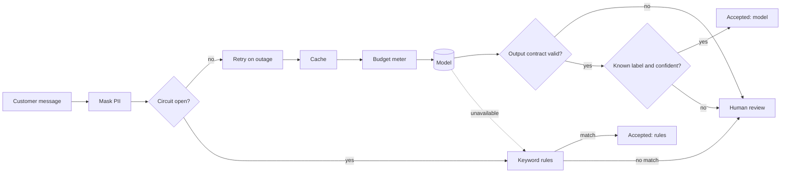

# Modern Java design patterns

[](https://github.com/alejandrolunatech/modern-java-design-patterns/actions/workflows/ci.yml)


Twelve classic GoF patterns rewritten in modern Java, and five patterns that keep an LLM in check. Every pattern has its code, its tests and a one-page note.

## Why now

Records, sealed types and pattern matching changed how several classic patterns are written. Visitor becomes a `switch`, State becomes one function, and most Strategies become a lambda. At the same time, many teams are putting language models into their services, and the same patterns are what keep those models honest: a port to hide the vendor, decorators for retries and budgets, a chain of guardrails, and a circuit breaker with a rules-based fallback.

The rule of the second half is **deterministic core, probabilistic edge**: the model proposes, and plain, tested code decides.

## What this shows

| Skill | Where to look |
| --- | --- |
| Sealed interfaces, records and exhaustive `switch` | [`Fees`](src/main/java/com/alejandrolunatech/patterns/gof/factory/Fees.java), [`OrderStateMachine`](src/main/java/com/alejandrolunatech/patterns/gof/state/OrderStateMachine.java) |
| Record patterns with guards (Java 21) | [`Operations.simplify`](src/main/java/com/alejandrolunatech/patterns/gof/visitor/Operations.java) |
| Functional design: strategies and chains as lambdas | [`ShippingCost`](src/main/java/com/alejandrolunatech/patterns/gof/strategy/ShippingCost.java), [`Approver`](src/main/java/com/alejandrolunatech/patterns/gof/chain/Approver.java) |
| Immutable commands with undo | [`Edit`](src/main/java/com/alejandrolunatech/patterns/gof/command/Edit.java) |
| Testable time: injected `Clock` and sleeper | [`DeduplicatingNotifier`](src/main/java/com/alejandrolunatech/patterns/gof/decorator/DeduplicatingNotifier.java), [`RetryingModelClient`](src/main/java/com/alejandrolunatech/patterns/llm/decorator/RetryingModelClient.java) |
| Ports and adapters around an LLM vendor | [`ModelClient`](src/main/java/com/alejandrolunatech/patterns/llm/core/ModelClient.java), [`ChatApiAdapter`](src/main/java/com/alejandrolunatech/patterns/llm/adapter/ChatApiAdapter.java) |
| PII masking and a strict output contract | [`GuardedClassifier`](src/main/java/com/alejandrolunatech/patterns/llm/guardrails/GuardedClassifier.java) |
| Cost control with exact money arithmetic | [`CostMeteringModelClient`](src/main/java/com/alejandrolunatech/patterns/llm/decorator/CostMeteringModelClient.java), [`RoutingStrategy`](src/main/java/com/alejandrolunatech/patterns/llm/routing/RoutingStrategy.java) |
| Resilience: circuit breaker and fallback | [`CircuitBreaker`](src/main/java/com/alejandrolunatech/patterns/llm/resilience/CircuitBreaker.java) |
| Architecture rules as tests | [`ArchitectureTest`](src/test/java/com/alejandrolunatech/patterns/ArchitectureTest.java) |

## The patterns

Each link opens the pattern's note: the problem, the code, what modern Java changes, and when not to use it.

| Classic GoF, in modern Java | For LLM-backed systems |
| --- | --- |
| [Strategy](src/main/java/com/alejandrolunatech/patterns/gof/strategy/README.md) | [The model port](src/main/java/com/alejandrolunatech/patterns/llm/core/README.md) |
| [Factory with sealed types](src/main/java/com/alejandrolunatech/patterns/gof/factory/README.md) | [Adapter for model providers](src/main/java/com/alejandrolunatech/patterns/llm/adapter/README.md) |
| [Builder](src/main/java/com/alejandrolunatech/patterns/gof/builder/README.md) | [Strategy for model routing](src/main/java/com/alejandrolunatech/patterns/llm/routing/README.md) |
| [Observer](src/main/java/com/alejandrolunatech/patterns/gof/observer/README.md) | [Decorators: retry, cache, budget](src/main/java/com/alejandrolunatech/patterns/llm/decorator/README.md) |
| [Decorator](src/main/java/com/alejandrolunatech/patterns/gof/decorator/README.md) | [Chain of guardrails](src/main/java/com/alejandrolunatech/patterns/llm/guardrails/README.md) |
| [Adapter](src/main/java/com/alejandrolunatech/patterns/gof/adapter/README.md) | [Circuit breaker and fallback](src/main/java/com/alejandrolunatech/patterns/llm/resilience/README.md) |
| [Facade](src/main/java/com/alejandrolunatech/patterns/gof/facade/README.md) | |
| [Template Method, and composition instead](src/main/java/com/alejandrolunatech/patterns/gof/templatemethod/README.md) | |
| [Chain of Responsibility](src/main/java/com/alejandrolunatech/patterns/gof/chain/README.md) | |
| [Command](src/main/java/com/alejandrolunatech/patterns/gof/command/README.md) | |
| [State, as a sealed state machine](src/main/java/com/alejandrolunatech/patterns/gof/state/README.md) | |
| [Visitor, replaced by pattern matching](src/main/java/com/alejandrolunatech/patterns/gof/visitor/README.md) | |

## How the LLM patterns fit together

[`SupportTriageExampleTest`](src/test/java/com/alejandrolunatech/patterns/llm/SupportTriageExampleTest.java) wires them into one support-ticket classifier:



What happens when something goes wrong:

| Failure | What the code does |
| --- | --- |
| The vendor times out or is overloaded | Retries with backoff, then the rules answer |
| The vendor keeps failing | The circuit opens and the rules answer at once, without waiting for timeouts |
| The answer is not in the two-line contract | Human review |
| The label is not one we know | Human review |
| The model is unsure (confidence below 0.7) | Human review |
| The budget is spent | The call is refused before it is made, with a `BudgetExceededException` the caller must handle |
| The message contains a card number, IBAN or email | Masked before it leaves the system |

No real model is called anywhere in this repo. Every test uses [`FakeModelClient`](src/main/java/com/alejandrolunatech/patterns/llm/core/FakeModelClient.java), so the results are the same on every run, and the build needs no API key. Evals against a real model live in the companion Spring Boot repo.

## Quickstart

You need Java 21 or newer. The Maven wrapper downloads Maven itself.

```bash
git clone https://github.com/alejandrolunatech/modern-java-design-patterns.git
cd modern-java-design-patterns
./mvnw verify
```

The build compiles with all warnings as errors and runs 80 tests, including the architecture rules.

## Tests and quality

- **Unit tests** for every pattern, written as examples you can read top to bottom (JUnit 6 and AssertJ).
- **Architecture rules** with ArchUnit: GoF patterns don't depend on each other, LLM patterns share only `llm.core`, and the two halves don't mix. Each pattern can be read, copied or deleted for a kata on its own.
- **CI** on every pull request: build and tests on Java 21 and Java 25, and a gitleaks secret scan over the full history.
- **No runtime dependencies.** See [ADR 0002](docs/adr/0002-no-runtime-dependencies.md).

## Decisions

- [ADR 0001: Java 21 as the baseline, tested on Java 25](docs/adr/0001-java-21-baseline.md)
- [ADR 0002: No runtime dependencies](docs/adr/0002-no-runtime-dependencies.md)
- [ADR 0003: A fake model client, and no network in tests](docs/adr/0003-fake-model-client.md)

## Trade-offs, and what I'd change for production

- **PII masking is regex-based.** It catches the common formats, not every one. Production needs a dedicated detector and an audit of what was masked.
- **The output contract is two plain lines.** A real service would use JSON with a schema and the provider's structured-output mode, as the Spring Boot repo does.
- **The circuit breaker and retry are hand-written** to show the mechanism. In a Spring service I'd use Resilience4j.
- **Token counts from the text adapter are estimates** (about four characters per token), and the code labels them as such.
- **The confidence score comes from the model itself**, so it is a weak signal. It only decides between "accept" and "ask a person"; evals on labelled data are what tell you whether to trust it.

## Practise it yourself

[KATAS.md](KATAS.md) explains how to delete a pattern's code and rebuild it from its tests, as practice for live-coding interviews.

## How this was built

Designed and reviewed by Alejandro Aguirre Luna. Implemented with AI coding agents (Claude Code) under my direction; I reviewed and merged every pull request and can walk through every decision. A self-directed portfolio project, not client or production work. All examples and data are made up.

My own notes on each pattern are in [docs/LEARNING-NOTES.md](docs/LEARNING-NOTES.md).

## License

Code: [MIT](LICENSE). Documentation (`*.md`): [CC BY 4.0](LICENSE-docs).
